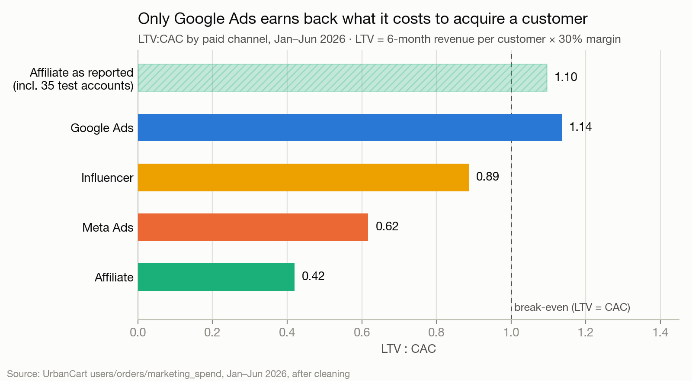
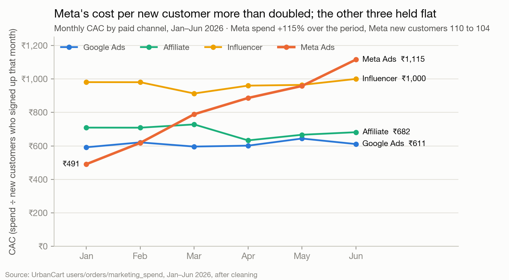
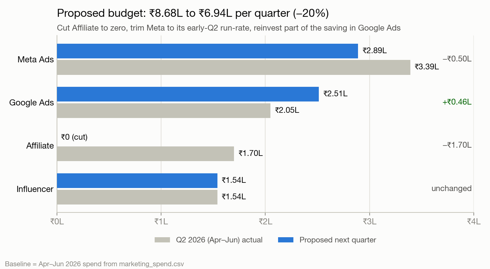

# Memo: cutting paid spend 20%

**To:** CMO · **From:** Data & AI Engineer, Growth · **Date:** 25 Oct 2026

**Decision.** Cut Affiliate to zero (−₹1.70L a quarter), trim Meta by ₹0.50L, and reinvest ₹0.46L of the saving in Google Ads. Paid spend falls from ₹8.68L (Apr–Jun) to ₹6.94L, exactly 20%.

| Channel | Apr–Jun | Next quarter |
|---|---|---|
| Meta Ads | ₹3.39L | ₹2.89L |
| Google Ads | ₹2.05L | ₹2.51L |
| Affiliate | ₹1.70L | ₹0 |
| Influencer | ₹1.54L | ₹1.54L |

**Why Affiliate.** It loses money on every measure: LTV:CAC 0.42, only 8% of customers reorder, 40% of orders cancelled or returned (under 10% elsewhere). It looked healthy only because 35 internal test accounts, all tagged Affiliate, placed 285 orders; without them revenue per customer is ₹957, not ₹2,339.

**Why trim Meta.** Spend doubled since January (₹54k to ₹1.16L a month) while new customers stayed flat (110 to 104); CAC rose from ₹491 to ₹1,115. The marginal rupees bought nothing, so removing ₹17k a month should cost few customers.

**Protect Google, hold Influencer.** Google is the only channel above break-even (LTV:CAC 1.14, CAC steady near ₹600 all six months), so it gets the reinvestment. Influencer brings the most valuable customers (₹2,858 each, 73% repeat) at a stable CAC: hold it, grow it next.

**Biggest risk.** Google could saturate as Meta did, and paid reach may feed Organic (461 customers at no cost). Watch weekly: Google CAC (pause the top-up above ₹700), Organic signups, blended CAC. Expect ~200 fewer new customers a quarter, almost all one-time Affiliate buyers; new-customer contribution falls ~₹0.3L against ₹1.74L saved.

---

*Workings, data-quality checks and definitions: Part 1.*
