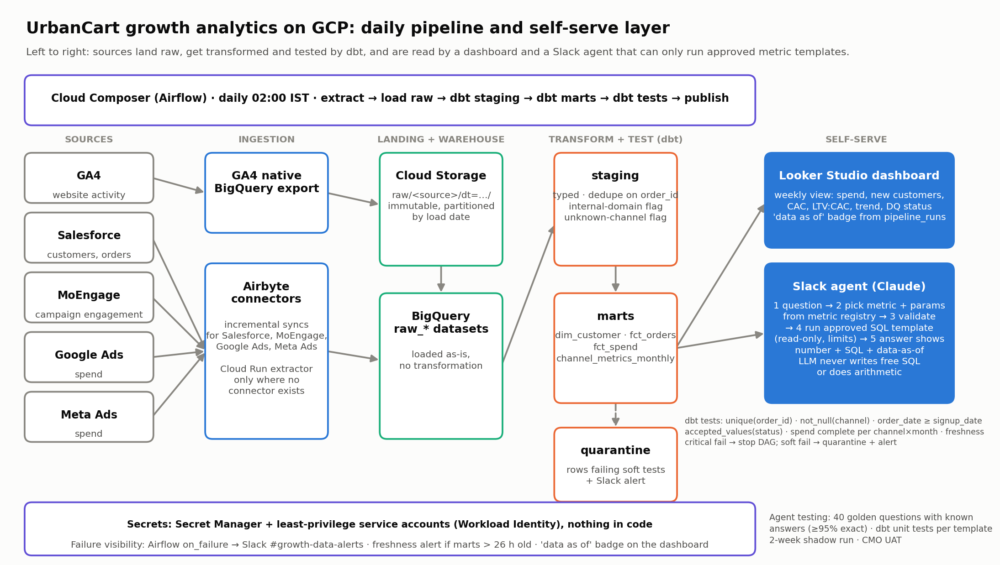

# Part 3: Design note

## A. Automate the pipeline

**Landing and warehouse.** On GCP (GA4 exports to BigQuery natively), each source lands raw and immutable in Cloud Storage, then loads as-is into BigQuery `raw_*` datasets, the warehouse Looker Studio reads directly. GA4 uses its native export; the rest use Airbyte connectors, or a Cloud Run extractor where none exists.

**Daily job.** A Cloud Composer (Airflow) DAG runs at 02:00 IST: extract → load raw → dbt staging → marts → tests → publish. Staging types, de-duplicates on `order_id` and flags internal and unknown-channel users; marts hold `dim_customer`, `fct_orders`, `fct_spend` and `channel_metrics_monthly`, the Part 1 metrics.

**Data-quality tests.** Each Part 1 finding is a dbt test: `unique(order_id)`; `not_null(acquisition_channel)`; exclusion of `@urbancart.in` and a test-account list; `order_date >= signup_date`; `accepted_values(status)`; spend complete per channel × month; source freshness. Critical failures stop the DAG before marts refresh; soft failures quarantine rows and alert.

**Secrets and failure.** Credentials live in Secret Manager, read by least-privilege service accounts; nothing in code. Failures post to Slack with the log link, a freshness alert fires if marts are over 26 hours old, and the dashboard shows a "data as of" badge so stale data is never silent.

## B. Make it self-serve

**What it is.** A Looker Studio dashboard on `channel_metrics_monthly` (spend, customers, CAC, LTV:CAC, trend, data quality), plus a Slack agent for questions like "What was Meta's CAC last month?".

**How it works.** (1) The CMO asks in Slack. (2) An LLM maps the question to one metric in a metric registry (the Part 1 definitions, each with a tested SQL template) and extracts channel, period and grain. (3) Code validates them. (4) The template runs on BigQuery via a read-only, rate-limited account. (5) The LLM wraps the returned number in one sentence; the reply shows the number, SQL and data-as-of date.

**Why it cannot invent numbers.** The model never writes free SQL or does arithmetic; it only picks a template and fills parameters. A checker rejects any reply with a number absent from the query result. Ambiguous or out-of-scope questions get a clarifying question, not a guess. Everything is logged.

**Testing.** Forty golden questions with answers known from Part 1 ("Meta CAC in March" → ₹789) must match 95% exactly on every prompt or model change; dbt unit tests per template; two weeks of shadow use reviewed by the data team; then UAT with the CMO.

