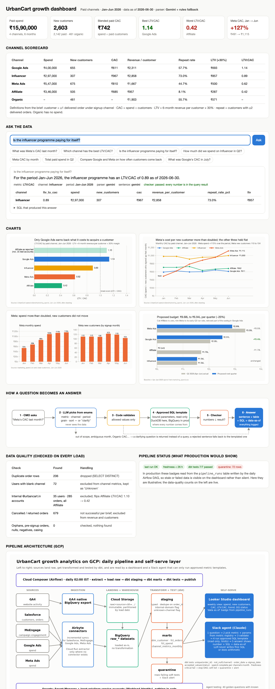

# Part 3 prototype: dashboard + self-serve agent, working

A small, runnable version of the self-serve layer described in `Part3_Design/Part3_Design_Note.md`: one local page with
live KPI tiles and a channel scorecard (computed from the same DuckDB clean layer the agent queries), the Part 1/2 charts,
an ask box backed by the conversational agent, a flow chart of how a question becomes an answer, live data-quality
counts, and the pipeline architecture. DuckDB stands in for BigQuery; everything else is the production design.

```bash
python Part3_Prototype/app.py "What was Meta's CAC last month?"   # one question, prints answer + SQL
python Part3_Prototype/app.py --serve                              # dashboard + ask box at http://localhost:8765
python -m unittest Part3_Prototype.test_golden -v                  # golden-question tests (no API key needed)
```

No extra packages: it reuses the repo's DuckDB clean layer. To use Gemini for parsing and phrasing, put
`GEMINI_API_KEY=...` in `Part3_Prototype/.env` (gitignored) or the environment; `GEMINI_MODEL` overrides the
default `gemini-3.5-flash-lite` (chosen for ~2 s latency; the larger flash models took 30–60 s on structured output). Without a key, a rule-based parser handles the question and the sentence is templated,
so reviewers can run everything offline.



## How a question becomes an answer

1. **Parse.** The question goes to Gemini with a JSON schema whose every field is an enum from `registry.py`:
   metric (7 options), channel, period (a month, Q1, Q2, H1), grain, sort, or `intent = clarify`.
   The model never sees the data and cannot output a number. If Gemini is unavailable, `rules_parse` does the same job with keywords.
2. **Validate.** Code checks the parameters: unknown metric, out-of-range month, or a spend metric for Organic
   each return a clarifying question instead of a query.
3. **Query.** One approved SQL template (`registry.TEMPLATE`) runs on DuckDB with bound parameters.
   The template encodes the Part 1 definitions, so for Jan–Jun it reproduces Part 1 exactly (the tests assert this).
4. **Phrase.** The result is formatted by code. If Gemini is on, it is asked for one sentence using only those
   formatted facts, and a **checker rejects the sentence if it contains any number not in the query result**,
   falling back to the templated sentence. The UI shows which path was used.
5. **Show the work.** Every reply carries the result table, the SQL that ran, the parser used, the checker verdict
   and the data-as-of date, and every question, SQL and answer is kept in `engine.log`.

## Files

| File | Role |
|---|---|
| `registry.py` | Metric definitions, allowed values, the one SQL template |
| `parser.py` | Rule-based parser; Gemini parser and phraser via REST (stdlib only); `.env` loading |
| `engine.py` | Validation, query execution, number checker, templated sentences, logging |
| `app.py` | CLI, the dependency-free dashboard page (tiles, scorecard, charts, flow chart, DQ status, ask box), `/api/summary`, static chart serving |
| `test_golden.py` | 14 golden answers, 4 must-clarify questions, a full cross-check against Part 1 tables, checker tests |

## What the live Gemini run looked like

Real outputs from `gemini-3.5-flash-lite` on questions the keyword parser cannot handle (every sentence passed the checker):

| Question | Parsed as | Answer |
|---|---|---|
| How much does it cost us to get a customer from Facebook these days? | CAC · Meta Ads · June 2026 | Meta Ads CAC for June 2026 was ₹1,115 |
| Is the influencer programme paying for itself? | LTV:CAC · Influencer · Jan–Jun | For Jan–Jun 2026, the influencer programme is not paying for itself as the LTV:CAC is 0.89 |
| Compare Google and Meta on how often customers come back | repeat rate · all · Jan–Jun | Google Ads had a repeat purchase rate of 57.7% while Meta Ads had 44.7% |
| What was our cheapest channel in May? | CAC · all · May · best | Google Ads was our cheapest channel with a CAC of ₹644, followed by Affiliate at ₹667, Meta Ads at ₹958, and Influencer at ₹964 |
| Tell me a joke about marketing | clarify | I can only help you with UrbanCart's paid channel metrics… |

When the free-tier quota returned HTTP 429 mid-run, the agent fell back to the rule-based parser and templated
sentence for those questions with no wrong numbers, and the reply says so (`parser: rules (gemini unavailable)`).
`GOLDEN_USE_GEMINI=1 python -m unittest Part3_Prototype.test_golden` runs the golden suite through Gemini.

## Limits, honestly

Six months of one brand's data, five channels, seven metrics. Multi-metric questions ("CAC and repeat rate")
answer the first metric found; comparisons across periods need two questions. The production version would add
these as more templates in the registry, not by letting the model write SQL.
